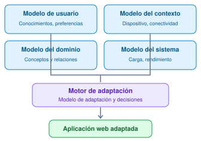
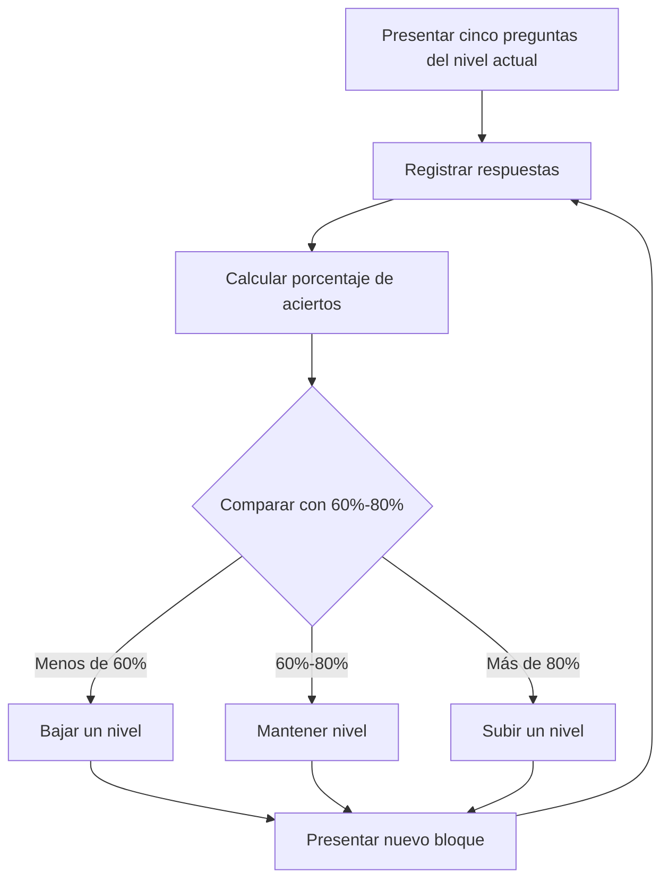
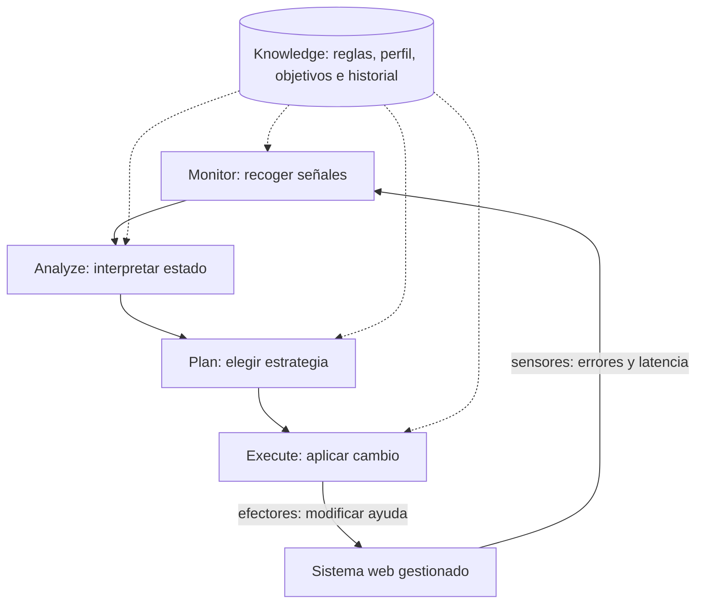
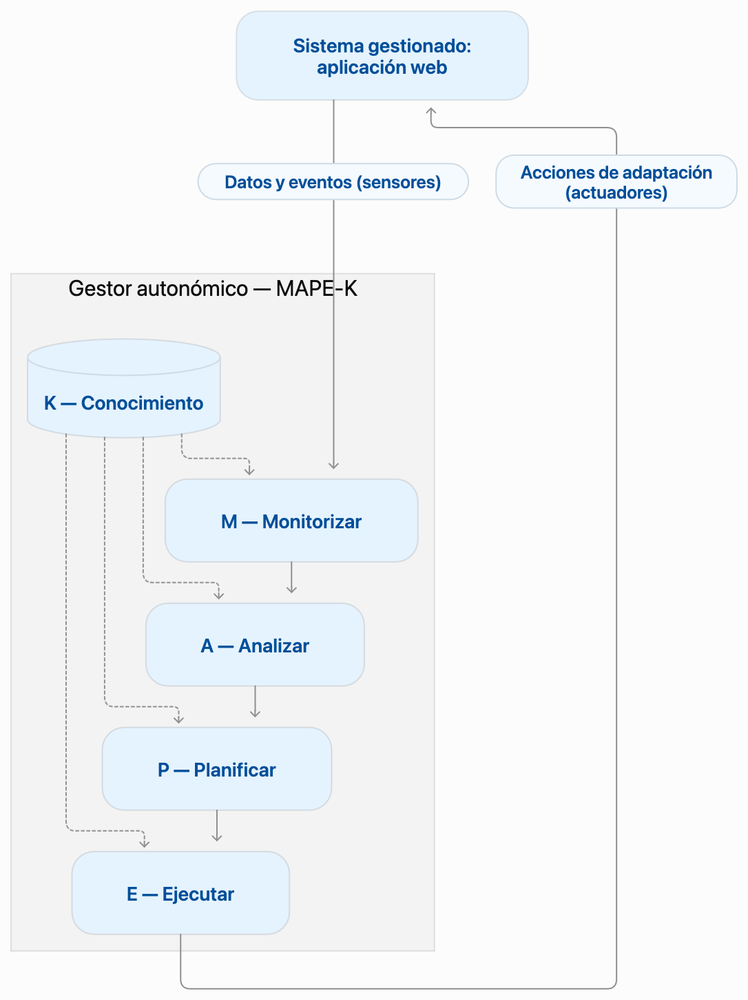

# Sistemas reactivos, adaptativos y autónomos
Diseñar aplicaciones web que no solo respondan a entradas, sino que puedan **observar condiciones relevantes, interpretar cambios, seleccionar una estrategia y modificar su comportamiento** con un objetivo verificable.

**Conocimientos previos:** componentes y estado en React, TypeScript básico, eventos, solicitudes HTTP y separación frontend/backend.

## Contexto
Considere una plataforma web de ejercicios. Un estudiante responde tres veces de manera incorrecta. La interfaz tradicional puede limitarse a mostrar «Respuesta incorrecta». Otra puede mostrar una pista cuando ocurre un error. Una tercera puede **reconocer un patrón** de dificultad, elegir entre estrategias pedagógicas definidas y observar después si disminuyen los errores. ¿Qué sistema es solamente reactivo? ¿Cuál está adaptándose? ¿En qué condiciones puede hablarse de autonomía?.

**Importante:** no todo cambio visual es adaptación. Una interfaz responsive que reacomoda sus columnas, por ejemplo, responde al tamaño de pantalla; por sí sola no demuestra que exista un controlador adaptativo con objetivos y evaluación. Puede considerarse una adaptación de presentación en sentido amplio, pero no equivale necesariamente a un sistema autoadaptativo completo.

---
## Sistemas reactivos, adaptativos y autónomos

| Aspecto | Reactivo | Adaptativo | Autónomo |
|---|---|---|---|
| Pregunta central | ¿Qué evento ocurrió? | ¿Debemos cambiar la estrategia? | ¿Qué decisión y acción puede ejecutar el sistema sin intervención continua? |
| Comportamiento típico | Regla evento → respuesta | Observación → selección de variante → ajuste | Decisión y ejecución automática bajo objetivos y restricciones |
| Ejemplo web | Mostrar validación al enviar formulario | Activar ayuda guiada cuando se acumulan intentos fallidos | Detectar degradación y conmutar un servicio siguiendo una política |
| Riesgo | Responder sin aprender del contexto | Adaptaciones inadecuadas o inestables | Acciones automáticas sin límites o supervisión |

Estas características **pueden coexistir**. Un sistema autoadaptativo suele reaccionar a señales del entorno y puede ejecutar ciertas adaptaciones autónomamente. No debemos convertir los términos en una escala rígida ni confundir autonomía con inteligencia artificial: una política determinista puede automatizar decisiones acotadas.

### Ejercicios de clasificación
1. Un botón deshabilita el formulario mientras se envía: principalmente **reactivo**.
2. Una web selecciona un modo de bajo consumo cuando detecta conexión limitada: **comportamiento adaptativo** según el contexto (si hay selección dinámica de estrategias).
3. Un servicio mide errores, analiza el patrón, conmuta de proveedor y comprueba recuperación: ejemplo de control autoadaptativo con ejecución **autónoma**. 

**¿Sistema Autoadaptativo?**
Un **sistema autoadaptativo** es un sistema informático capaz de supervisar su funcionamiento y modificar automáticamente su comportamiento, configuración o estructura durante la ejecución, sin requerir intervención humana directa para cada cambio.

La característica principal es la **capacidad de gestionar automáticamente su propia adaptación**.

Los sistemas autoadaptativos pueden utilizar arquitecturas de control como MAPE-K, aunque esta no es obligatoria.

**Ejemplo:**
Una aplicación web monitoriza continuamente sus tiempos de respuesta.

1. Detecta que el tiempo de respuesta supera un umbral establecido.
2. Analiza las condiciones de funcionamiento.
3. Determina una estrategia para reducir la carga.
4. Cambia automáticamente a un modo de procesamiento simplificado.
5. Vuelve a medir los tiempos de respuesta para evaluar el resultado.

El sistema decide y ejecuta la adaptación durante su funcionamiento.

**¿Sistema autónomo?**
Un **sistema autónomo** es un sistema capaz de tomar decisiones y ejecutar acciones para alcanzar objetivos definidos, operando con cierto grado de independencia respecto de la intervención humana.

La característica principal es su **capacidad de decidir y actuar para alcanzar objetivos**.

**Ejemplo:**
Un agente de software recibe el objetivo de organizar las tareas pendientes de un proyecto.

El agente puede:

1. Identificar las tareas pendientes.
2. Analizar prioridades y fechas límite.
3. Determinar el orden de ejecución.
4. Asignar tareas según las reglas disponibles.
5. Supervisar el cumplimiento de los objetivos.

En este caso, el sistema toma decisiones operativas dentro de los objetivos y restricciones establecidos.

## Diferencias entre los sistemas

| Característica | Adaptativo | Autoadaptativo | Autónomo |
|---|---|---|---|
| Propósito principal | Ajustar su funcionamiento | Gestionar automáticamente su adaptación | Alcanzar objetivos con independencia |
| Capacidad distintiva | Adaptación | Autoajuste durante la ejecución | Toma de decisiones y actuación |
| Cambia su comportamiento | Sí | Sí | No necesariamente |
| Requiere intervención humana en cada cambio | No necesariamente | No | No necesariamente |
| Puede utilizar reglas | Sí | Sí | Sí |
| Puede utilizar Machine Learning | Sí | Sí | Sí |
| Puede implementar MAPE-K | Sí | Sí | Sí |
| Ejemplo | Personalización de ejercicios | Ajuste automático del procesamiento | Agente de gestión de tareas |

---

## Sistemas Adaptativos
Un sistema adaptativo (Adaptive System, AS) es un sistema informático capaz de modificar su comportamiento, configuración, parámetros o estructura en respuesta a cambios en su entorno, en las características de sus usuarios o en sus condiciones internas, con el propósito de mantener o mejorar el cumplimiento de sus objetivos. 

Los sistemas adaptativos son aquellos capaces de ajustar automáticmente sus parámetros en **tiempo real** para mantener los niveles de rendimiento deseados, especialmente ante incertidumbres y condiciones variables en el tiempo[1].

Algunas definiciones de autores: 
- Andersson et al. [2] definen un SA como un sistema autoadaptativo, ya que son capaces de modificarse durante su ejecución frente a cambios en el entorno, los requisitos o el propio sistema. 
- Salehie and Tahvildari [3] explican la autoadapatción mediante mecanismos de retroalimentación que permiten observar cambios, evaluar la situación y ajustar el funcionamiento del SW. 

**Características fundamentales**
Un sistema adaptativo puede incorporar las siguientes capacidades[5]: 
1. **Observación**: Recopilar información del usuario, del entorno o de su funcionamiento.
2. **Interpretación**: Identificar condiciones que justifican una modificación. 
3. **Decisión**: Determinar qué comportamiento o configuración resulta conveniente. 
4. **Adaptación**: Modificar parámetros, funcionalidades, contenidos, recursos o componentes. 
5. **Evaluación**: Comprobar si el cambio contribuye a los objetivos del sistema. 

**Un ejemplo sería**
Consideremos una plataforma educativa que presenta actividades a estudiantes.
- El sistema registra resultados de ejercicios.
- Detecta dificultades reiteradas en un concepto.
- Determina que el nivel actual de dificultad no es adecuado.
- Selecciona actividades más sencillas y materiales complementarios.
- Evalúa si los resultados mejoran.
*En este caso, el sistema adapta su comportamiento a las necesidades de aprendizaje del usuario.*

**Importante:**: Un sistema adaptativo no necesita utilizar *inteligencia artificial ni aprendizaje automático*. Puede adaptarse mediante reglas previamente programadas, modelos de usuario, algoritmos de optimización o técnicas de IA.

---
## Tipos de SA
Acordando a Abrahão et al. [4] la adaptación puede ser estática, dinámica e híbrida. **La estática** se relaciona con que las variantes y configuraciones del sistema se seleccionan antes de su ejecución. **La dinámica** se relaciona que el sistema modifica su comportamiento o configuración mientras funciona. **La híbrida** combina variantes definidas previamente con decisiones de adaptación durante la ejecución.

Según el tipo usado puede usarse diferentes mecanismos para su implementación: 

1. **Basado en reglas** utiliza condiciones y acciones predefinidas.
    - *Ejemplo*: Si un estudiante obtiene menos de 60%, asigna ejercicios de refuerzo.
2. **Basado en modelos** utiliza representaciones del usuario, contexto o sistema para tomar decisiones.
    - *Ejemplo*: selecciona contenidos según un modelo de conocimientos del estudiante.
 
### Ejemplo de Plataforma Educativa basada en modelos



**Modelo A. Usuario**
Representa el estado de aprendizaje del estudiante.
```JSON
{
  "estudiante": "E001",
  "conocimientos": {
    "variables": 0.90,
    "condicionales": 0.75,
    "funciones": 0.35
  },
  "objetivo": "aprender_funciones"
}
```
**Modelo B. Dominio**
Representa las dependencias entre conceptos de programación.
```JSON
{
  "concepto": "funciones",
  "prerrequisitos": [
    "variables",
    "condicionales"
  ],
  "actividades": [
    "funciones_basico",
    "funciones_intermedio",
    "funciones_avanzado"
  ]
}
```
**Modelo C. Adaptación**
Establece la estrategia para seleccionar las actividades.

```JSON
function seleccionarActividad(nivel) {
  if (nivel < 0.5) {
    return "funciones_basico";
  }

  if (nivel < 0.8) {
    return "funciones_intermedio";
  }

  return "funciones_avanzado";
}
```
Si quiere profundizar ir a [leer](https://link.springer.com/article/10.1007/s10270-021-00909-7)

---

3. **Basado en retroalimentación** Compara métricas observadas con objetivos y corrige desviaciones.
    - *Ejemplo*: Ajusta recursos del servidor para mantener un tiempo de respuesta aceptable.

 ### Ejemplo de plataforma de autoevaluación adaptativa
Una universidad dispone de una plataforma de autoevaluación para aprender programación web. Inicialmente, todas las personas reciben ejercicios del mismo nivel. Esto puede resultar demasiado fácil para algunos estudiantes y demasiado difícil para otros.

Se propone incorporar un mecanismo que **ajuste automáticamente la dificultad** después de cada bloque de cinco preguntas, utilizando el porcentaje de respuestas correctas.

**Pregunta de diseño:** ¿Cómo puede la plataforma utilizar el desempeño observado para modificar las próximas actividades y volver a evaluar el efecto de ese cambio?

**Alternativa**

| Porcentaje de aciertos | Adaptación |
|------------------------|-------------------|
|Menor que 60%.          |Disminuir un nivel |
|Entre 60% y 80%.        |Mantener el nivel  | 
|Mayor que 80%           |Aumentar un nivel  |

#### Ciclo de retroalimentación


En estos sistemas de adaptación basados en retroalimentación hay una *politica de adaptación*, el cual puede definirse como un conjunto de reglas, criterios o decisiones que establece bajo qué condiciones un sistema debe modificar su comportamiento, qué cambios debe realizar y qué restricciones debe respetar, con el propósito de cumplir determinados objetivos. A continuación describimos los componentes de una política de adaptación. 

| Componente | Descripción |
|---|---|
| **Objetivo** | Establece qué se busca alcanzar mediante la adaptación. |
| **Variable observada** | Define qué información se utiliza para evaluar el estado del sistema. |
| **Condición de adaptación** | Determina cuándo debe realizarse un cambio. |
| **Acción de adaptación** | Especifica qué comportamiento o configuración se modificará. |
| **Restricciones** | Establece límites para evitar comportamientos no deseados. |
| **Frecuencia de evaluación** | Determina cuándo se vuelven a evaluar las condiciones. |


**Política de adaptación**
| Resultados en un bloque de 5 | Porcentaje | Decisión |
|---|---:|---|
| 0, 1 o 2 correctas | 0%, 20% o 40% | Reducir nivel en 1, sin bajar de 1 |
| 3 o 4 correctas | 60% u 80% | Mantener nivel |
| 5 correctas | 100% | Aumentar nivel en 1, sin superar 3 |

**Restricciones:**

- Nivel mínimo: 1 (básico).
- Nivel máximo: 3 (avanzado).
- No se permite disminuir por debajo del nivel 1.
- No se permite aumentar por encima del nivel 3.

**Frecuencia de evaluación:** al finalizar cada bloque de cinco preguntas.

**Implementación de la política en JavaScript**
```javascript
function politicaAdaptacion(porcentaje, nivelActual) {
  let nuevoNivel = nivelActual;

  if (porcentaje < 60) {
    nuevoNivel--;
  } else if (porcentaje > 80) {
    nuevoNivel++;
  }

  // Respetar las restricciones
  return Math.max(1, Math.min(3, nuevoNivel));
}

// Ejemplos de ejecución
console.log(politicaAdaptacion(40, 2)); // 1
console.log(politicaAdaptacion(80, 2)); // 2
console.log(politicaAdaptacion(100, 2)); // 3
```

---

4. **Basada en aprendizaje** utiliza datos o experiencias para mejorar sus decisiones. Según Sutton y Barto (2018) [9], el aprendizaje por refuerzo permite que un agente aprenda a seleccionar acciones mediante la interacción con un entorno y la evaluación de las recompensas obtenidas. Se pueden integrar **técnicas Machine Learning** para que el sistema aprenda patrones a partir de los datos y utilice ese conocimiento para tomar decisiones de adaptación.
    -  *Ejemplo*: Aprende qué actividades recomendar según los resultados anteriores

**Características principales**
| Característica | Descripción |
|---|---|
| Datos o experiencias | Utiliza información de interacciones pasadas o actuales. |
| Modelo de aprendizaje | Mantiene estimaciones o patrones obtenidos de los datos. |
| Decisión adaptativa | Selecciona acciones considerando el conocimiento aprendido. |
| Actualización | Incorpora nueva información para modificar sus estimaciones. |
| Evaluación | Observa los resultados para valorar las decisiones realizadas. |

### Ejemplo de plataforma web que aprende qué estrategia de apoyo utilizar

**Escenario:**

Una plataforma web presenta ejercicios de programación a estudiantes.

Cuando un estudiante necesita ayuda, el sistema puede ofrecer dos estrategias:

- **Estrategia A:** mostrar un ejemplo resuelto paso a paso.
- **Estrategia B:** mostrar una pista contextual para que el estudiante continúe por sí mismo.

Inicialmente, el sistema no sabe cuál estrategia produce mejores resultados.

A medida que los estudiantes interactúan con la plataforma, registra los resultados de ejercicios posteriores y aprende qué estrategia tiene una mayor tasa de éxito.

**Objetivo:** seleccionar la estrategia de apoyo que produce mejores resultados según la información acumulada.

**Variable observada:** resultado de una pregunta de comprobación posterior a la ayuda (correcta o incorrecta).

**Acciones disponibles:** mostrar un ejemplo guiado o una pista contextual.

**Resultado utilizado para aprender:** 1 cuando la respuesta posterior es correcta y 0 cuando es incorrecta.

**Política de adaptación basada en aprendizaje**

A diferencia de una política que utiliza únicamente umbrales fijos, la decisión incorpora estimaciones obtenidas mediante experiencias anteriores.

| Situación | Acción |
|---|---|
| Una estrategia aún no tiene observaciones | Probarla para obtener información. |
| Una estrategia presenta mejores resultados estimados | Priorizar su selección. |
| Se necesita evaluar otras alternativas | Explorar ocasionalmente otra estrategia. |
| Se obtiene un nuevo resultado | Actualizar las estimaciones de éxito. |

Este enfoque introduce dos conceptos:

- **Exploración:** probar diferentes acciones para obtener nueva información.
- **Explotación:** seleccionar las acciones que han mostrado mejores resultados.

**Algoritmo de aprendizaje simplificado**

Se utilizará una técnica de selección conocida como *epsilon-greedy*, que combina exploración y explotación.

```javascript
const estrategias = ["ejemplo", "pista"];

const estadisticas = {
  ejemplo: { intentos: 0, aciertos: 0 },
  pista: { intentos: 0, aciertos: 0 }
};

// Seleccionar la estrategia
function seleccionarEstrategia() {
  const noProbadas = estrategias.filter(
    e => estadisticas[e].intentos === 0
  );

  if (noProbadas.length > 0) {
    return noProbadas[
      Math.floor(Math.random() * noProbadas.length)
    ];
  }

  // Exploración: 20% de probabilidad
  if (Math.random() < 0.20) {
    return estrategias[
      Math.floor(Math.random() * estrategias.length)
    ];
  }

  // Explotación: elegir la mayor tasa observada
  return estrategias.reduce((mejor, actual) => {
    const tasaActual =
      estadisticas[actual].aciertos /
      estadisticas[actual].intentos;

    const tasaMejor =
      estadisticas[mejor].aciertos /
      estadisticas[mejor].intentos;

    return tasaActual > tasaMejor ? actual : mejor;
  });
}

// Incorporar una nueva experiencia
function registrarResultado(estrategia, correcta) {
  const datos = estadisticas[estrategia];

  datos.intentos++;

  if (correcta) {
    datos.aciertos++;
  }
}
```
--- 

4. **Hibrido** Combina dos o más mecanismos.
    - *Ejemplo*: Utiliza reglas pedagógicas junto con un modelo predictivo de dificultades.

## Arquitectura MAPE-K

MAPE-K (Monitor, Analyze, Plan, Execute-Knowledge) es un modelo de referencia para diseñar sistemas autoadaptativos capaces de supervisar su funcionamiento, analizar cambios, planificar modificaciones y ejecutarlas automáticamente mediante un ciclo de retroalimentación. 

Fue desarrollada en el contexto de la computación autonómica (Autonomic Computing), impulsada por IBM[10] , y constituye una de las arquitecturas de referencia más utilizadas para organizar los mecanismos de autoadaptación en sistemas de software (Kephart & Chess, 2003; White et al., 2004).

### Componentes de MAPE-K

| Componente | Significado | Función |
|---|---|---|
| **M – Monitor** | Monitorizar | Recopila información del sistema y de su entorno mediante sensores. |
| **A – Analyze** | Analizar | Examina la información recopilada e identifica situaciones que requieren adaptación. |
| **P – Plan** | Planificar | Determina las acciones necesarias según los objetivos y las políticas de adaptación. |
| **E – Execute** | Ejecutar | Aplica las acciones de adaptación mediante mecanismos de ejecución. |
| **K – Knowledge** | Conocimiento | Mantiene modelos, políticas, objetivos, estados e información histórica. |

**Importante:** Knowledge (K) no representa una etapa posterior a Execute. Es un componente compartido que proporciona información a las cuatro actividades del ciclo.




| Fase | Responsabilidad | Ejemplo educativo | Evidencia observable |
|---|---|---|---|
| Monitor (M) | Capturar y preparar señales | Contar errores consecutivos por actividad | Evento y marca temporal |
| Analyze (A) | Detectar necesidad de ajuste | Identificar dificultad persistente tras 3 errores | Estado «requiere refuerzo» |
| Plan (P) | Evaluar alternativas y elegir | Seleccionar modalidad de ayuda | Decisión y regla aplicada |
| Execute (E) | Cambiar el sistema gestionado | Mostrar explicación guiada | Interfaz actualizada |
| Knowledge (K) | Compartir políticas, modelos e historial | Perfil, umbrales, preferencia

**Diagrama de la arquitectura MAPE-K**




### Ejemplo: Plataforma Web Educativa Adaptativa usando MAPE-K
Una plataforma web presenta ejercicios de programación organizados en tres niveles de dificultad:

- Nivel 1: Básico.
- Nivel 2: Intermedio.
- Nivel 3: Avanzado.

El sistema debe adaptar automáticamente la dificultad de los ejercicios según el desempeño observado de cada estudiante.

**Objetivo:** seleccionar actividades con un nivel de dificultad apropiado para los resultados observados.

**Variable observada:** porcentaje de respuestas correctas en un bloque de cinco preguntas.

### Política de adaptación

| Porcentaje de aciertos | Acción de adaptación |
|---|---|
| Menor que 60% | Disminuir un nivel de dificultad. |
| Entre 60% y 80% (inclusive) | Mantener el nivel actual. |
| Mayor que 80% | Aumentar un nivel de dificultad. |

**Restricciones:**

- El nivel mínimo es 1.
- El nivel máximo es 3.
- La evaluación se realiza al finalizar cada bloque de cinco preguntas.


### Aplicación de MAPE-K

Supongamos que un estudiante está en el nivel intermedio y responde correctamente dos de cinco preguntas.

| Componente | Aplicación |
|---|---|
| **Monitorizar** | Registrar 2 respuestas correctas de 5. |
| **Analizar** | Calcular un 40% de aciertos e identificar que está bajo el umbral. |
| **Planificar** | Determinar que debe disminuirse la dificultad del nivel 2 al nivel 1. |
| **Ejecutar** | Seleccionar y presentar ejercicios del nivel básico. |
| **Knowledge** | Mantener el nivel del estudiante, historial y política de adaptación. |

## Implementación de MAPE-K en JavaScript
**Knowledge: base de conocimiento**

```javascript
const conocimiento = {
  nivel: 2,
  historial: [],
  politica: {
    minimo: 1,
    maximo: 3,
    umbralInferior: 60,
    umbralSuperior: 80
  }
};
```

**Monitor: monitorizar**

Registra los resultados obtenidos por el estudiante.

```javascript
function monitorizar(respuestas) {
  const correctas = respuestas.filter(
    respuesta => respuesta === true
  ).length;

  return (correctas / respuestas.length) * 100;
}
```
**Analyze: analizar**

Evalúa el desempeño según la política de adaptación.

```javascript
function analizar(porcentaje) {
  const politica = conocimiento.politica;

  if (porcentaje < politica.umbralInferior) {
    return "disminuir";
  }

  if (porcentaje > politica.umbralSuperior) {
    return "aumentar";
  }

  return "mantener";
}
```

**planificar**

Determina el nuevo nivel de dificultad.

```javascript
function planificar(decision) {
  let nuevoNivel = conocimiento.nivel;

  if (decision === "disminuir") {
    nuevoNivel--;
  }

  if (decision === "aumentar") {
    nuevoNivel++;
  }

  return Math.max(
    conocimiento.politica.minimo,
    Math.min(
      conocimiento.politica.maximo,
      nuevoNivel
    )
  );
}
```

**Execute: ejecutar**

Actualiza el nivel y almacena los resultados del ciclo.

```javascript
function ejecutar(nuevoNivel, porcentaje) {
  const nivelAnterior = conocimiento.nivel;

  conocimiento.nivel = nuevoNivel;

  conocimiento.historial.push({
    porcentaje,
    nivelAnterior,
    nuevoNivel
  });

  // En una aplicación real se cargarían
  // las preguntas correspondientes al nuevo nivel.

  return conocimiento.historial.at(-1);
}
```

**Integración del ciclo MAPE-K**

```javascript
function cicloMAPEK(respuestas) {
  const porcentaje = monitorizar(respuestas);

  const decision = analizar(porcentaje);

  const nuevoNivel = planificar(decision);

  return ejecutar(nuevoNivel, porcentaje);
}

// Dos respuestas correctas de cinco
const resultado = cicloMAPEK([
  true,
  false,
  true,
  false,
  false
]);

console.log(resultado);
```

**Resultado esperado:**
```json
{
  "porcentaje": 40,
  "nivelAnterior": 2,
  "nuevoNivel": 1
}
```
---

# Referencias
[1]Benyon, D., & Murray, D. (1993). Adaptive systems: From intelligent tutoring to autonomous agents. Knowledge-Based Systems, 6(4), 197–219.

[2] Andersson, J., de Lemos, R., Malek, S., & Weyns, D. (2009). Modeling dimensions of self-adaptive software systems. En Software Engineering for Self-Adaptive Systems (pp. 27–47). Springer. https://doi.org/10.1007/978-3-642-02161-9_2

[3] Salehie, M., & Tahvildari, L. (2009). Self-adaptive software: Landscape and research challenges. ACM Transactions on Autonomous and Adaptive Systems, 4(2), Article 14. https://doi.org/10.1145/1516533.1516538.

[4] Abrahão, S., Insfran, E., Sluÿters, A., & Vanderdonckt, J. (2021). Model-based intelligent user interface adaptation: Challenges and future directions. Software and Systems Modeling, 20, 1335–1349. https://doi.org/10.1007/s10270-021-00909-7

[5] Feigh, K. M., Dorneich, M. C., & Hayes, C. C. (2012). Toward a characterization of adaptive systems: A framework for researchers and system designers. Human Factors, 54(6), 1008–1024.

[6] De Bra, P. M. E., Houben, G. J. P. M., & Wu, H. (1999). AHAM: A Dexter-based reference model for adaptive hypermedia. *Proceedings of the 10th ACM Conference on Hypertext and Hypermedia*, 147–156. https://doi.org/10.1145/294469.294508

[7] Kephart, J. O., & Chess, D. M. (2003). The vision of autonomic computing. *Computer, 36*(1), 41–50. https://doi.org/10.1109/MC.2003.1160055

[8] Salehie, M., & Tahvildari, L. (2009). Self-adaptive software: Landscape and research challenges. *ACM Transactions on Autonomous and Adaptive Systems, 4*(2), Article 14. https://doi.org/10.1145/1516533.1516538

[9] Sutton, R. S., & Barto, A. G. (2018). *Reinforcement learning: An introduction* (2nd ed.). MIT Press. https://mitpress.mit.edu/9780262039246/reinforcement-learning/

[10] BM. (2005). Problem determination using self-managing autonomic technology (SG24-6665-00). IBM Redbooks.

[11] White, S. R., Hanson, J. E., Whalley, I., Chess, D. M., & Kephart, J. O. (2004). An architectural approach to autonomic computing. Proceedings of the First International Conference on Autonomic Computing, 2–9.

[12] Kephart, J. O., & Chess, D. M. (2003). The vision of autonomic computing. Computer, 36(1), 41–50.